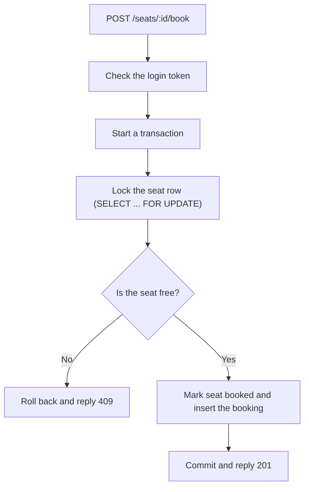
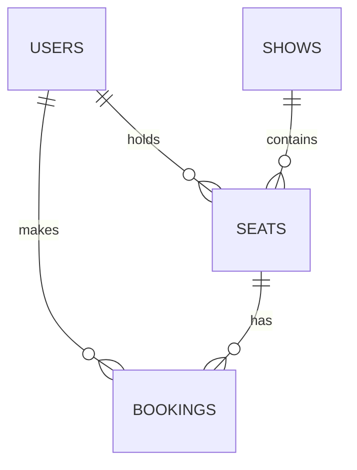

# Booking System with Concurrency Handling

A backend booking system that prevents the same seat from being booked twice, even when multiple users try to book it at the same time.

## What problem does it solve?

Imagine one seat is left and two people click "Book" together. A badly built system checks "is the seat free?" for both, gets "yes" twice, and sells the seat to both.

This project stops that. It uses database transactions and row locks, so the second person waits, then sees the seat is gone and gets a clear "already booked" reply. A database rule sits underneath as a second safety layer.

## Features

- Sign up and log in with JWT (passwords are hashed with bcrypt)
- View the seats of a show and their status
- Book a seat safely (transaction + row lock)
- Hold a seat for 5 minutes while paying; the hold ends by itself
- Cancel a booking, which frees the seat for others
- Booking history for each user (cancelled bookings are kept)
- Automated tests that fire many requests at the same seat at once
- Runs with one command using Docker Compose

## Tech Stack


<p >
  
  
  
  
</p>

## How a booking works



If two users book the same seat together, the first one gets the lock. The second one waits at the lock, and when it gets in, it reads the fresh data, sees the seat is booked, and gets a 409.

## Two layers of protection

1. **Row lock (main layer):** `SELECT ... FOR UPDATE` makes requests for the same seat wait in line.
2. **Unique rule (safety net):** the `bookings` table has a unique column `active_seat_id`. It holds the seat ID while a booking is confirmed and becomes `NULL` when cancelled. So the database itself refuses a second active booking for the same seat, even if the code had a bug. Because `NULL` values don't clash, a cancelled seat can be booked again.

## Seat holds

- Holding a seat sets its status to `held`, saves who holds it, and saves the time the hold ends (5 minutes from now).
- Expired holds are **not** cleaned up by a background job. Every time a seat is read, the code checks if the hold time has passed. If yes, it is treated as available. This is called lazy expiry.
- All time checks use MySQL's own clock (`NOW()`), so there is only one clock to trust.

## Database



- **users:** name, unique email, password hash
- **shows:** title, show time
- **seats:** one row per seat per show, with status (`available`, `held`, `booked`), who holds it, and when the hold ends
- **bookings:** who booked which seat, status (`confirmed`, `cancelled`), and `active_seat_id`

## API routes

| Method | Route | Login needed | What it does |
|---|---|---|---|
| GET | /health | No | Checks the server is running |
| POST | /auth/signup | No | Creates an account |
| POST | /auth/login | No | Returns a JWT token |
| GET | /auth/me | Yes | Shows the logged-in user |
| GET | /shows/:id/seats | No | Lists seats and their status |
| POST | /seats/:id/hold | Yes | Holds a seat for 5 minutes |
| POST | /seats/:id/book | Yes | Books a seat |
| GET | /bookings/me | Yes | Shows my booking history |
| DELETE | /bookings/:id | Yes | Cancels my booking |

Send the token as `Authorization: Bearer <token>`.

Common replies: `201` created, `400` bad input, `401` not logged in, `404` not found, `409` seat not available.

## Run with Docker (easiest)

1. Copy `.env.example` to `.env` and set `JWT_SECRET` to any long random text
2. Run:
```bash
   docker compose up --build
```
3. The API is at `http://localhost:3000`. Try `GET /shows/1/seats`.

The database starts with one demo show and 10 seats.

## Run without Docker

1. Start only MySQL:
```bash
   docker compose up -d mysql
```
2. Install libraries:
```bash
   npm install
```
3. Copy `.env.example` to `.env` and fill it in (MySQL is on port 3307 from your computer)
4. Start the server:
```bash
   npm run dev
```

## Run the tests

MySQL must be running.

```bash
npm test
```

The tests create their own users, show and seats, and delete them at the end. They check that:

- 20 users booking the same seat at once: exactly 1 wins and 19 are refused
- One user clicking Book 10 times creates only 1 booking
- 20 users holding the same seat at once: exactly 1 gets it
- A held seat can't be booked by others, but the holder can book it
- Cancelling the same booking 5 times at once frees the seat only once


## Design decisions

- **Transactions with row locks:** the seat update and the booking insert happen together or not at all.
- **Unique rule as a safety net:** the database refuses double bookings even if the code is wrong.
- **Lazy hold expiry:** no background job to fail silently, and the answer is always correct at the moment of reading.
- **Soft delete for cancellations:** cancelled bookings are kept for history; only `active_seat_id` is cleared.
- **Let the database decide uniqueness:** signup relies on the unique email rule instead of "check, then insert", which would have a race.
- **Same error for wrong email and wrong password:** so attackers can't find out which emails have accounts.
- **404 for someone else's booking:** it doesn't reveal that the booking exists.
- **User ID comes from the token, never from the request body.**

## Limits and ideas for later
- Tested on one app server and one database; not load tested at large scale
- A seat-grid page in React would make the demo easier to see